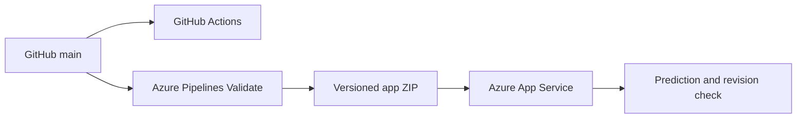

# Flask prediction on Azure App Service

[](https://github.com/samuelstefancic/udacity-azure-flask-cicd/actions/workflows/ci.yml)

A small Flask API serves the Boston housing regression model supplied by Udacity. GitHub Actions runs lint and tests. Azure Pipelines runs the same checks before packaging and deploying the application, then calls the prediction endpoint to confirm the revision and response.



## Run locally

Use Python 3.12, Make, Bash and curl.

```bash
python3.12 -m venv .venv
source .venv/bin/activate
make all
gunicorn --bind 127.0.0.1:8000 --access-logfile - app:app
```

From a second terminal, run `./make_prediction.sh`. The expected response is `{"prediction":[2.431574790057212]}`. `sample-prediction.json` contains the six input columns as maps of row IDs to values. A request with a missing column, inconsistent row IDs or a non-finite value returns HTTP 400.

## Run on Azure

1. Push the project to GitHub and confirm the CI workflow is green. Clone the same commit into Azure Cloud Shell, activate a Python 3.12 environment and run `make all` followed by `make test`.
2. In the Udacity subscription, use the existing resource group and pick the SKU allowed by your lab. Set `AZURE_SKU` and run `./commands.sh bootstrap "$RESOURCE_GROUP" "$APP_NAME"` from the clone. The script uses `az webapp up`, configures the Python build and startup command, and prints the actual HTTPS endpoint.
3. In Azure DevOps, connect the GitHub repository and create a pipeline from `azure-pipelines.yml`. Set variables `appResourceGroup` and `appServiceName`. The file defaults to a Linux agent pool named `udacity-linux` and an Azure Resource Manager service connection named `udacity-app-service`. Use those names or set the corresponding YAML parameters. On a self-hosted lab agent, install Python 3.12 with `venv`, Make, Azure CLI and curl. Use a project-specific connection scoped to the lab resource group and authorize it for this pipeline.
4. Run the pipeline on `main`. `Validate` runs the checks and packages the current commit. `Deploy` uses the artifact from that run, calls `/predict` and compares `X-Revision` to the pipeline commit.
5. Run `./commands.sh predict "$RESOURCE_GROUP" "$APP_NAME"` from Cloud Shell. Run `./commands.sh logs "$RESOURCE_GROUP" "$APP_NAME"` in a second Cloud Shell window to see the request and prediction logs.

Python and Azure references are available in the [App Service quickstart](https://learn.microsoft.com/en-us/azure/app-service/quickstart-python), the [Azure CLI task reference](https://learn.microsoft.com/en-us/azure/devops/pipelines/tasks/reference/azure-cli-v2) and the [Azure service connection guide](https://learn.microsoft.com/en-us/azure/devops/pipelines/library/connect-to-azure).

## Plan and submission evidence

- [Project plan](docs/project-plan.xls) with the original estimates, current status and quarterly and yearly milestones.
- [Trello card list](docs/trello-cards.md) with due dates and completion evidence. The live board link is pending.
- [Screencast outline](docs/demo.md). The recording and its link are pending.
- [Local build and tests](preuves/make-all.log) and [HTTP run from the unpacked deployment artifact](preuves/packaged-http.log).

The Udacity submission still needs real captures of the Cloud Shell clone, `make all`, `make test`, the GitHub Actions build and badge, Azure Pipelines, App Service and the remote prediction from Cloud Shell. The project uses [rubric 2860](https://learn.udacity.com/rubric/2860).

## Model and next improvement

The binary model comes from [Udacity’s starter at `a239a57`](https://github.com/udacity/nd082-Azure-Cloud-DevOps-Starter-Code/tree/a239a572c6d6153317f29841973b49a9f78a84f9/C2-AgileDevelopmentwithAzure/project/starter_files/flask-sklearn). It was serialized with scikit-learn 1.1.3. The project uses the starter’s scikit-learn 1.5.1, which emits `InconsistentVersionWarning`. The supplied model passes the regression test on Python 3.12.

The original API scales each request independently. With one row, all scaled features are zero and the model returns its intercept. For a future release, train and export preprocessing and model together, then validate multiple reference cases. The current API preserves the course behavior.
